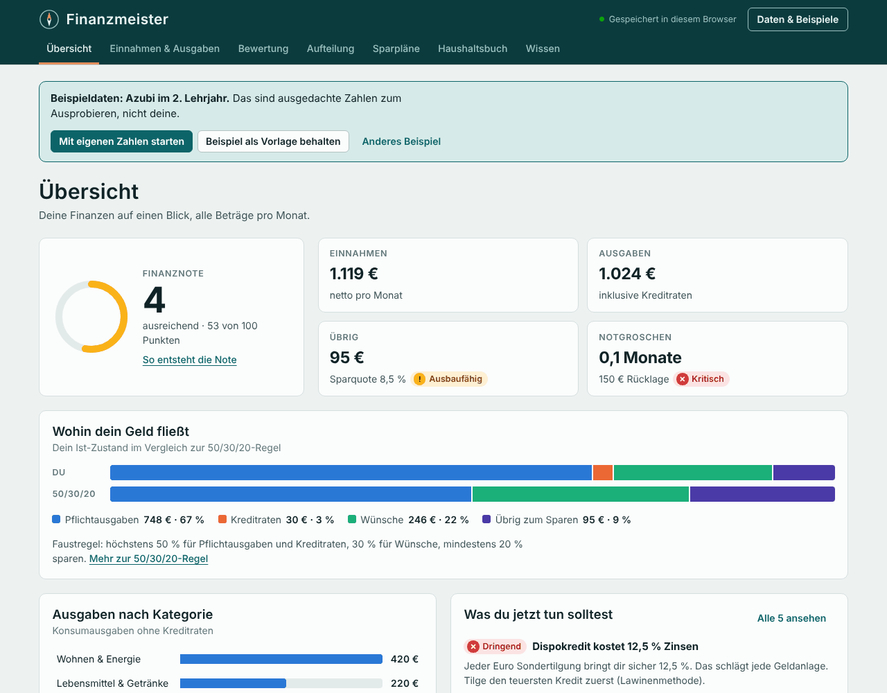
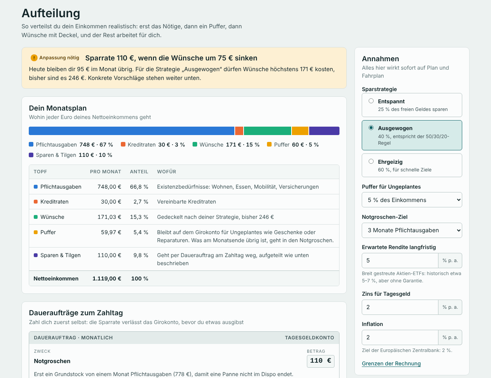
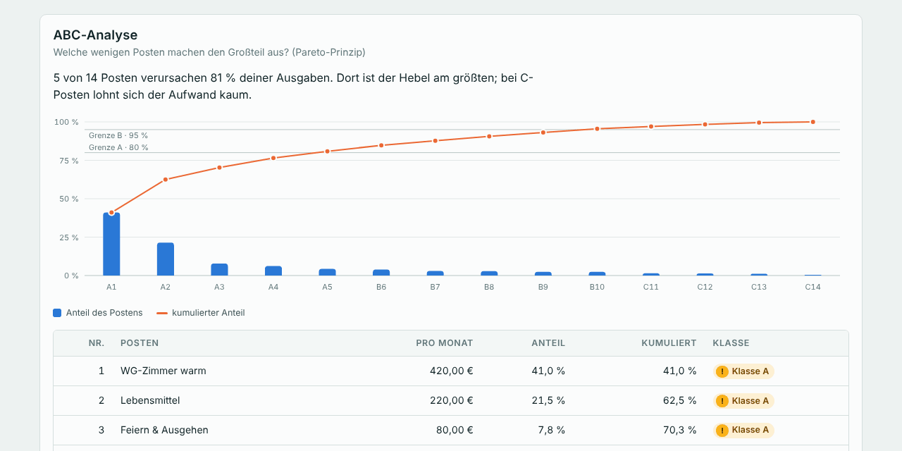

# Finanzmeister

Der **Finanzmeister** ist eine Web-App für die eigenen Finanzen: Sie **stellt Einnahmen und Ausgaben übersichtlich dar**,
**bewertet jede Ausgabe mit Methoden aus Volks- und Betriebswirtschaft**, **teilt das Geld realistisch
auf** und **erstellt Sparpläne** mit Fahrplan bis zum Ziel. Alles läuft im Browser, ohne Server,
ohne Anmeldung und ohne Abhängigkeiten.



## So bekommst du die App – Schritt für Schritt

Du brauchst nur einen Computer, ein Tablet oder ein Handy mit einem **Browser**.
Ein Browser ist das Programm, mit dem du Internetseiten anschaust, zum Beispiel
**Chrome**, **Edge**, **Firefox** oder **Safari**.
Die App kostet nichts. Du musst dich nirgends anmelden.

Es gibt zwei Wege. Such dir einen aus.

### Weg 1: Im Internet öffnen (am einfachsten)

1. Öffne deinen Browser.
2. Klicke oben in das lange Feld, in dem sonst die Internetadresse steht.
3. Schreibe genau das hinein: `yourworstdream.github.io/Finanzmeister`
4. Drücke die Taste **Enter**. Auf dem Handy tippst du auf **Los** oder **Öffnen**.
5. Fertig! Jetzt siehst du den Finanzmeister.

Oder klicke einfach hier: **[Finanzmeister öffnen](https://yourworstdream.github.io/Finanzmeister/)**

**Tipp fürs Handy oder Tablet:** Du kannst die App wie ein richtiges App-Symbol auf deinen Startbildschirm legen.

- **iPhone oder iPad (Safari):** Tippe auf das Teilen-Zeichen (ein Viereck mit einem Pfeil nach oben).
  Tippe dann auf **„Zum Home-Bildschirm“** und danach auf **„Hinzufügen“**.
- **Android (Chrome):** Tippe oben rechts auf die drei Punkte.
  Tippe dann auf **„Zum Startbildschirm hinzufügen“** und danach auf **„Hinzufügen“**.

**Es kommt nur eine Fehlerseite mit „404“?** Dann ist die Webseite noch nicht eingeschaltet.
Nimm dann Weg 2. Oder bitte die Person, der das Projekt gehört, den Teil
[„Webseite einschalten“](#webseite-einschalten-nur-einmal-nur-für-den-besitzer) unten zu machen.

### Weg 2: Auf den Computer holen (geht danach auch ohne Internet)

1. Öffne diese Seite: <https://github.com/Yourworstdream/Finanzmeister>
2. Suche den grünen Knopf **„Code“**. Er ist oben rechts über der Liste mit den Dateien. Klicke darauf.
3. Ein kleines Fenster geht auf. Klicke darin ganz unten auf **„Download ZIP“**.
4. Dein Computer lädt jetzt eine Datei herunter. Sie heißt **Finanzmeister-main.zip**.
   Du findest sie im Ordner **Downloads**.
5. Eine ZIP-Datei ist wie ein zugeklebtes Paket. Du musst sie erst auspacken:
   - **Windows:** Klicke mit der **rechten** Maustaste auf die Datei.
     Klicke dann auf **„Alle extrahieren …“** und danach auf **„Extrahieren“**.
   - **Mac:** Klicke zweimal schnell (Doppelklick) auf die Datei. Dann geht das Paket von allein auf.
     Manchmal hat der Mac das schon von selbst gemacht. Dann ist der Ordner schon da.
6. Jetzt gibt es einen neuen Ordner. Er heißt **Finanzmeister-main**. Öffne ihn mit einem Doppelklick.
7. Darin liegt die Datei **index.html**. Manchmal steht dort nur **index**, mit einem kleinen Browser-Bild davor.
   Mache einen Doppelklick darauf.
8. Fertig! Der Finanzmeister geht in deinem Browser auf.

**Wichtig:** Lass alle Dateien zusammen in dem Ordner.
Die Datei **index.html** braucht den Ordner **assets** direkt daneben. Sonst funktioniert die App nicht.

### Das erste Mal in der App

1. Zuerst siehst du Beispielzahlen von einem Azubi. Das sind nicht deine Zahlen. Sie sind nur zum Ausprobieren.
2. Klicke auf **„Mit eigenen Zahlen starten“**.
3. Klicke auf **„+ Einnahme“**. Trage ein, wie viel Geld du bekommst, zum Beispiel dein Taschengeld.
   Klicke dann auf **„Speichern“**.
4. Klicke auf **„+ Ausgabe“**. Trage ein, wofür du Geld ausgibst, zum Beispiel für Süßigkeiten.
   Klicke wieder auf **„Speichern“**. Das machst du für jede Ausgabe.
5. Schau dir oben die Bereiche an: **Übersicht**, **Bewertung**, **Aufteilung** und **Sparpläne**.
   Unter **Wissen** wird alles noch einmal in Ruhe erklärt.

### Gut zu wissen

- Deine Zahlen bleiben auf deinem Gerät. Sie werden nicht ins Internet geschickt. Niemand sonst kann sie sehen.
- Die App merkt sich deine Zahlen nur in **diesem** Browser auf **diesem** Gerät.
  Auf einem anderen Gerät fängst du neu an.
- Die Version aus dem Internet (Weg 1) und die heruntergeladene Version (Weg 2) merken sich ihre Zahlen getrennt.
- Du willst deine Zahlen aufheben oder auf ein anderes Gerät mitnehmen?
  Klicke oben rechts auf **„Daten & Beispiele“** und dann auf **„Als Datei speichern“**.
  Auf dem anderen Gerät klickst du auf **„Daten & Beispiele“**, dann bei **„Sicherungsdatei wählen“** auf die Datei,
  und danach auf **„Daten übernehmen“**.
- Wenn du im Browser den Verlauf **und die Website-Daten** löschst, sind auch deine Zahlen weg.
  Speichere sie vorher als Datei.

### Webseite einschalten (nur einmal, nur für den Besitzer)

Damit Weg 1 funktioniert, muss die Person, der das Projekt auf GitHub gehört, die Webseite einmal einschalten.
Danach macht GitHub die Webseite bei jeder Änderung von allein neu.

1. Öffne <https://github.com/Yourworstdream/Finanzmeister> und melde dich bei GitHub an.
2. Klicke oben auf **„Settings“** (das Zahnrad).
3. Klicke links in der Liste auf **„Pages“**.
4. Suche **„Source“** und stelle es auf **„GitHub Actions“**.
5. Klicke oben auf **„Actions“**. Wähle links **„Webseite“** aus.
6. Klicke rechts auf **„Run workflow“** und dann auf den grünen Knopf **„Run workflow“**.
7. Warte ein bis zwei Minuten. Wenn neben dem Lauf ein grüner Kreis mit Haken ist, ist die Webseite online.

### Für Fortgeschrittene

- Lokaler Webserver: `npm start` (bzw. `python3 -m http.server 8000`) im Projektordner, dann `http://localhost:8000` öffnen.
- Beim ersten Start ist ein Beispielhaushalt geladen (Azubi im 2. Lehrjahr). Über **Daten & Beispiele**
  gibt es zwei weitere (Berufseinsteiger, Familie).
- Der Workflow `.github/workflows/pages.yml` testet die App vor jeder Veröffentlichung und lädt nur
  `index.html` und `assets/` hoch. Solange Pages nicht eingeschaltet ist, endet er grün mit einem Hinweis.

## Was die App kann

| Bereich | Inhalt |
|---|---|
| **Übersicht** | Finanznote nach IHK-Notenschlüssel, Einnahmen, Ausgaben, Überschuss, Notgroschen, Geldfluss im Vergleich zur 50/30/20-Regel, Ausgaben nach Kategorie, die drei wichtigsten nächsten Schritte |
| **Einnahmen & Ausgaben** | Regelmäßige Posten mit Intervall (wöchentlich bis jährlich), Kategorie, Bedürfnisart, fix/variabel und Nutzungen pro Monat; Kredite mit Restlaufzeit und Zinskosten; Rücklagen |
| **Bewertung** | Sechs Kennzahlen mit Ampel, 50/30/20-Regel, Bedürfnisarten, ABC-Analyse mit Pareto-Diagramm, Vergleich mit dem Durchschnittshaushalt, Opportunitätskosten, Kosten pro Nutzung, ein Urteil mit Begründung für jede Ausgabe, Empfehlungen |
| **Aufteilung** | Monatsplan für jeden Euro, Daueraufträge zum Zahltag, konkrete Kürzungsvorschläge, Fahrplan mit Phasen und Meilensteinen, Vermögensentwicklung nominal und real |
| **Sparpläne** | Je Ziel: nötige Rate, Rate im Plan, voraussichtliches Datum, passende Anlageform mit magischem Dreieck; Sparplan-Rechner mit Dynamik, Inflation und Umkehrrechnung |
| **Haushaltsbuch** | Buchungen erfassen, Fixposten mit einem Klick übernehmen, Soll-Ist-Vergleich je Kategorie, Verlauf der letzten zwölf Monate |
| **Wissen** | Alle verwendeten ökonomischen Grundlagen kurz erklärt; jede Bewertung verlinkt dorthin |



## Ökonomische Grundlagen

**Bewertung der Ausgaben**

* **Bedürfnisarten** – Existenz-, Kultur- und Luxusbedürfnisse; Existenzbedürfnisse sind der „Bedarf“ der 50/30/20-Regel.
* **Ökonomisches Prinzip** – Minimalprinzip für Verträge (gleicher Nutzen, weniger Geld), Maximalprinzip für variable Großposten.
* **Kennzahlen** – Sparquote, Notgroschen-Reichweite, Pflichtausgaben-Anteil, Fixkostenquote, Wohnkostenquote
  (Überlastung ab 40 % nach Eurostat), Schuldendienstquote. Bei kleinem Einkommen gelten nach dem
  Engel-Gesetz mildere Grenzen.
* **ABC-Analyse / Pareto-Prinzip** – A-Posten (bis 80 % der Summe) zeigen, wo Sparen am meisten bringt.
* **Durchschnittshaushalt** – Anteile an den Konsumausgaben laut Statistischem Bundesamt
  (Laufende Wirtschaftsrechnungen 2024), mit Hinweis auf Engel- und Schwabe-Gesetz.
* **Opportunitätskosten** – was jede verzichtbare Ausgabe in 10, 20 und 30 Jahren angelegt wert wäre.
* **Grenznutzen** – Kosten pro Nutzung bei Abos und Mitgliedschaften (erstes Gossensches Gesetz).

**Realistische Aufteilung**

1. Pflichtausgaben und Kreditraten zuerst.
2. Ein Puffer für Ungeplantes (Standard 5 % des Einkommens) bleibt auf dem Girokonto.
3. Vom freien Rest wird nach Strategie gespart: entspannt 25 %, ausgewogen 40 % (entspricht bei 50 %
   Pflichtausgaben genau 50/30/20), ehrgeizig 60 %. Wer schon weniger für Wünsche ausgibt, spart den Rest;
   wer mehr ausgibt, bekommt konkrete Kürzungen (Luxus zuerst halbieren, Kultur um höchstens ein Viertel;
   nur wenn das nicht reicht, fällt Luxus ganz weg und Kultur sinkt um bis zur Hälfte).
4. Die Sparrate fließt nach der **Finanzpyramide**: Notgroschen-Grundstock (ein Monat Pflichtausgaben),
   teure Kredite ab 8 % mit der **Lawinenmethode**, Notgroschen auffüllen parallel zu Sparzielen nach
   Priorität, Kredite über der erwarteten Rendite, dann Vermögensaufbau.
5. Der Fahrplan wird **Monat für Monat simuliert** – mit Zinsen, Kreditraten und frei werdenden Raten,
   die in die Sparrate fließen (Schneeball-Effekt).

**Sparpläne**

* Zinseszins mit konformem Monatszins, Dynamik, Inflation (Kaufkraft heute), 72er-Regel.
* Anlageform nach Laufzeit und **magischem Dreieck** (Sicherheit, Verfügbarkeit, Rendite):
  bis 3 Jahre Tagesgeld, bis 10 Jahre Mischung, darüber ETF.



## Aufbau

```
index.html               Seitengerüst und Wissensteil
assets/logik.js          Rechenkern: Analyse, Bewertung, Aufteilung, Simulation, Zinsrechnung (ohne Oberfläche)
assets/beispiele.js      Drei Beispielhaushalte
assets/diagramme.js      SVG-Diagramme mit Tooltip für Maus und Tastatur
assets/app.js            Oberfläche: Ansichten, Formulare, Speichern, Import/Export
assets/style.css         Gestaltung, helles und dunkles Farbschema
assets/favicon.svg       Symbol (Kompass)
tests/logik.test.js      Tests für den Rechenkern
bilder/                  Bildschirmfotos für diese README
.github/workflows/       Tests (test.yml) und Veröffentlichung auf GitHub Pages (pages.yml)
```

`logik.js` und `beispiele.js` laufen im Browser und in Node. Die Oberfläche rechnet nichts selbst.

## Tests

```bash
npm test          # Rechenkern testen (node --test tests/logik.test.js)
npm run check     # Syntax aller Skripte prüfen
```

Es gibt keine Abhängigkeiten, `npm install` ist nicht nötig; Node.js ab Version 20 reicht. Die Tests laufen
bei jedem Push und Pull Request automatisch in GitHub Actions (`.github/workflows/test.yml`).

## Datenschutz und Sicherheit

* Alle Daten bleiben im `localStorage` des Browsers. Es gibt keine Netzwerkzugriffe, keine Schriften
  oder Skripte von fremden Servern.
* Sichern und Wiederherstellen über **Daten & Beispiele** (JSON-Datei oder Zwischenablage). Sicherungsdateien
  (`finanzmeister-*.json`) enthalten persönliche Daten und stehen deshalb in `.gitignore`.
* Importierte Daten werden vollständig geprüft und bereinigt; alle Texte werden beim Anzeigen maskiert.

## Grenzen

Der Finanzmeister ist ein Lern- und Planungswerkzeug, keine Anlage-, Steuer- oder Schuldnerberatung.
Renditen sind Annahmen, Steuern (Abgeltungsteuer über dem Sparerpauschbetrag) sind nicht eingerechnet,
und der Fahrplan geht von gleichbleibendem Einkommen und gleichbleibenden Ausgaben aus.
